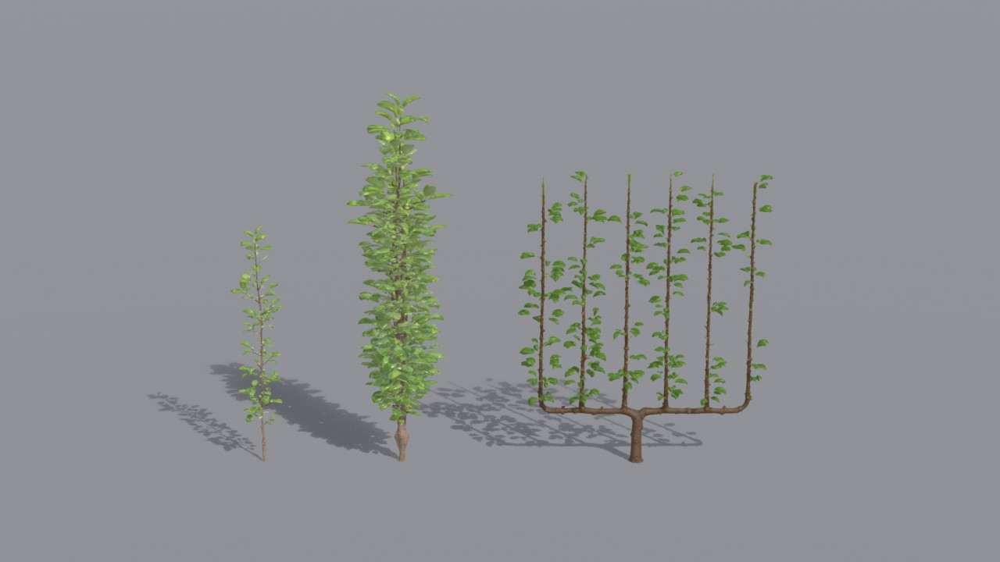
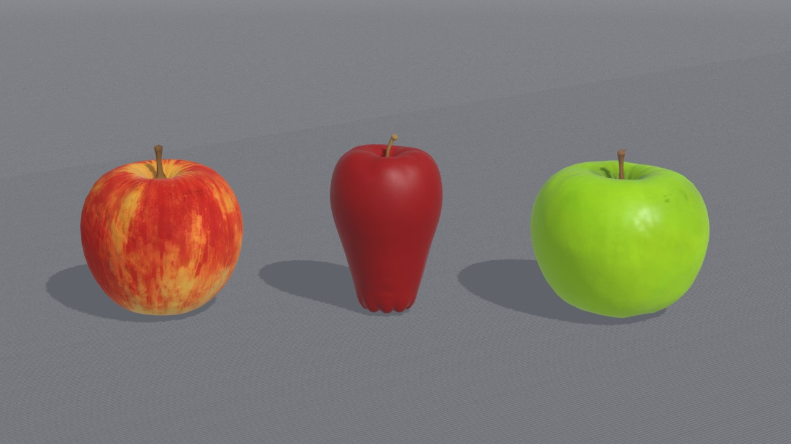

# Apple

Three orchard forms: a young spindle tree, a full spindle tree, and a flat fruiting wall (the form grown for picking from the ground or by machine). Three apples: round red, tall red, flat green. Posts and wires are not part of the models.

## File

`apple.blend` (29 MB, Blender 4.4 or newer). Textures are packed inside the file.

| Collection | What is in it |
|---|---|
| `Plants` | the plant models, side by side |
| `Fruit` | the fruit models, in a row in front of the plants |
| `Preview` | the floor, sun and camera used for the pictures above (delete it if you do not need it) |

## Models

| Object | Kind | Size in metres (x, y, z) | Triangles |
|---|---|---|---|
| `apple_spindle_young` | plant | 0.40 x 0.34 x 1.80 | 150,000 |
| `apple_spindle_full` | plant | 0.79 x 0.71 x 2.80 | 150,000 |
| `apple_wall_full` | plant | 1.86 x 0.35 x 2.21 | 150,000 |
| `apple_round_red` | fruit | 0.071 x 0.072 x 0.075 | 1,632 |
| `apple_tall_red` | fruit | 0.050 x 0.048 x 0.080 | 1,660 |
| `apple_flat_green` | fruit | 0.079 x 0.080 x 0.073 | 1,692 |

Each model is one object with one material (base colour, metal and roughness, normal map), named after the model.
Everything is at real size: 1 Blender unit is 1 metre, Z is up. A plant's origin is at the foot of its stem, so it stands on the ground when placed at a point.
