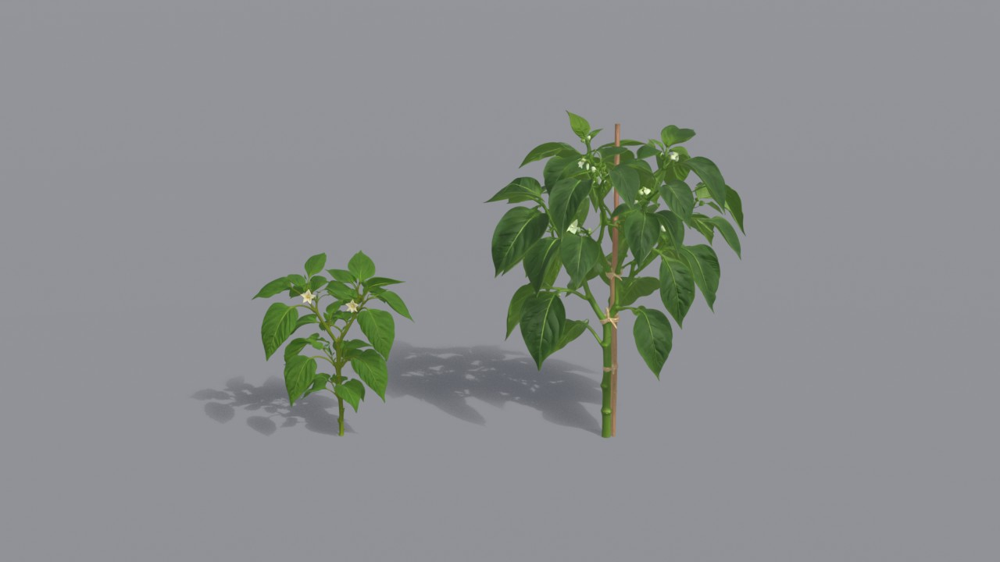
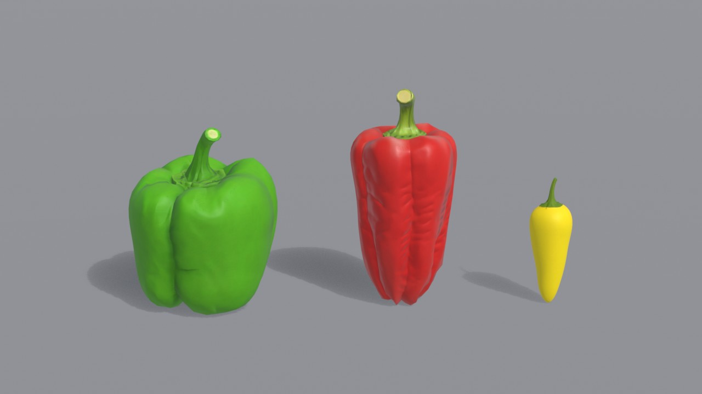

# Bell pepper

A young and a full grown plant, and three peppers: blocky green, tall red, mini yellow.

## File

`bellpepper.blend` (17 MB, Blender 4.4 or newer). Textures are packed inside the file.

| Collection | What is in it |
|---|---|
| `Plants` | the plant models, side by side |
| `Fruit` | the fruit models, in a row in front of the plants |
| `Preview` | the floor, sun and camera used for the pictures above (delete it if you do not need it) |

## Models

| Object | Kind | Size in metres (x, y, z) | Triangles |
|---|---|---|---|
| `pepper_plant_young` | plant | 0.35 x 0.25 x 0.40 | 150,000 |
| `pepper_plant_full` | plant | 0.57 x 0.43 x 0.70 | 150,000 |
| `pepper_blocky_green` | fruit | 0.080 x 0.082 x 0.10 | 1,836 |
| `pepper_tall_red` | fruit | 0.057 x 0.055 x 0.12 | 1,776 |
| `pepper_mini_yellow` | fruit | 0.023 x 0.022 x 0.070 | 1,648 |

Each model is one object with one material (base colour, metal and roughness, normal map), named after the model.
Everything is at real size: 1 Blender unit is 1 metre, Z is up. A plant's origin is at the foot of its stem, so it stands on the ground when placed at a point.
