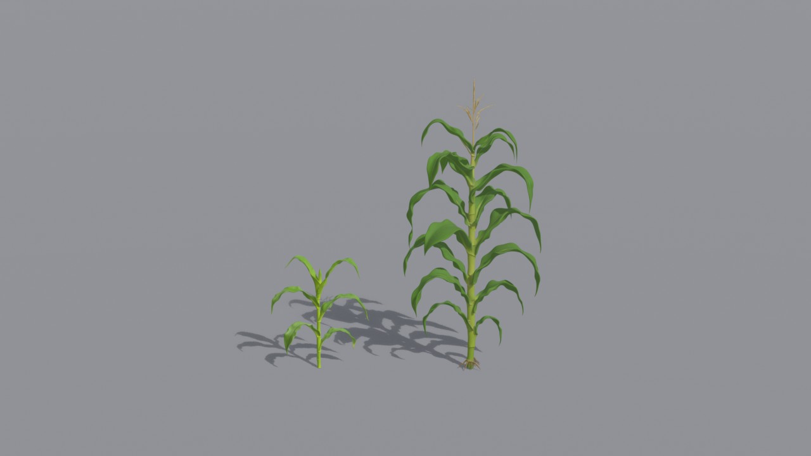
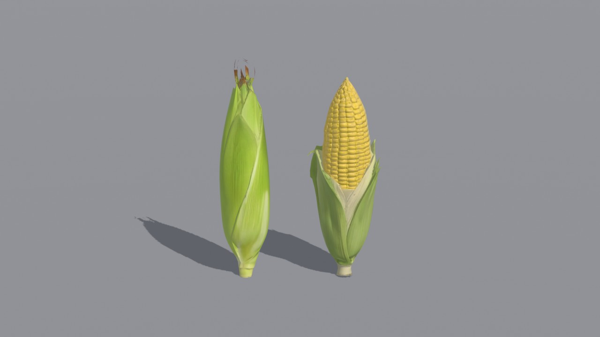

# Corn

A young and a full grown plant, and two ears: in the husk, and with the husk open.

## File

`corn.blend` (16 MB, Blender 4.4 or newer). Textures are packed inside the file.

| Collection | What is in it |
|---|---|
| `Plants` | the plant models, side by side |
| `Fruit` | the fruit models, in a row in front of the plants |
| `Preview` | the floor, sun and camera used for the pictures above (delete it if you do not need it) |

## Models

| Object | Kind | Size in metres (x, y, z) | Triangles |
|---|---|---|---|
| `corn_plant_young` | plant | 0.77 x 0.25 x 0.90 | 150,000 |
| `corn_plant_full` | plant | 1.07 x 0.76 x 2.30 | 150,000 |
| `corn_ear_husk` | fruit | 0.049 x 0.051 x 0.22 | 1,528 |
| `corn_ear_open` | fruit | 0.072 x 0.061 x 0.20 | 1,775 |

Each model is one object with one material (base colour, metal and roughness, normal map), named after the model.
Everything is at real size: 1 Blender unit is 1 metre, Z is up. A plant's origin is at the foot of its stem, so it stands on the ground when placed at a point.
