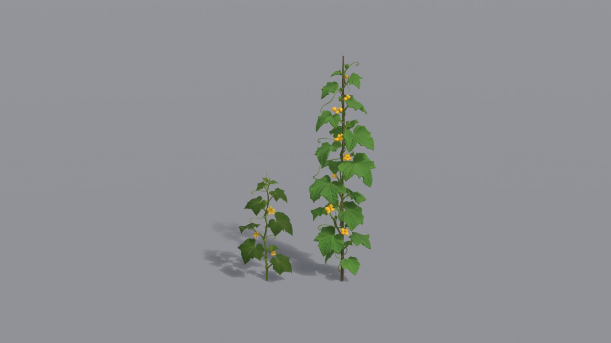
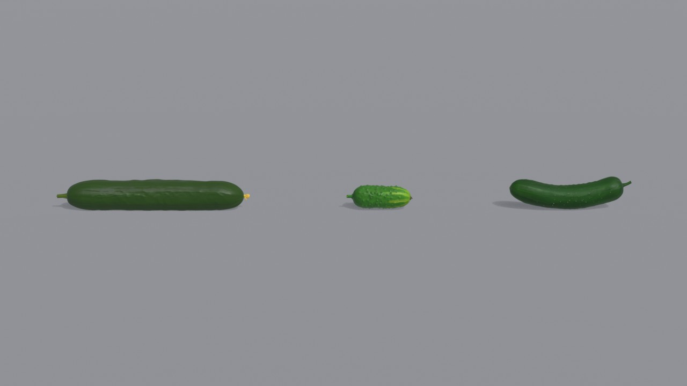

# Cucumber

A young and a full grown vine, and three fruits: long (English type), pickling, and a curved slicer.

## File

`cucumber.blend` (23 MB, Blender 4.4 or newer). Textures are packed inside the file.

| Collection | What is in it |
|---|---|
| `Plants` | the plant models, side by side |
| `Fruit` | the fruit models, in a row in front of the plants |
| `Preview` | the floor, sun and camera used for the pictures above (delete it if you do not need it) |

## Models

| Object | Kind | Size in metres (x, y, z) | Triangles |
|---|---|---|---|
| `cucumber_vine_young` | plant | 0.44 x 0.26 x 0.90 | 150,000 |
| `cucumber_vine_full` | plant | 0.51 x 0.47 x 1.80 | 150,000 |
| `cucumber_long` | fruit | 0.32 x 0.052 x 0.050 | 39,999 |
| `cucumber_pickling` | fruit | 0.11 x 0.044 x 0.042 | 40,000 |
| `cucumber_curved` | fruit | 0.20 x 0.044 x 0.055 | 39,999 |

Each model is one object with one material (base colour, metal and roughness, normal map), named after the model.
Everything is at real size: 1 Blender unit is 1 metre, Z is up. A plant's origin is at the foot of its stem, so it stands on the ground when placed at a point.
