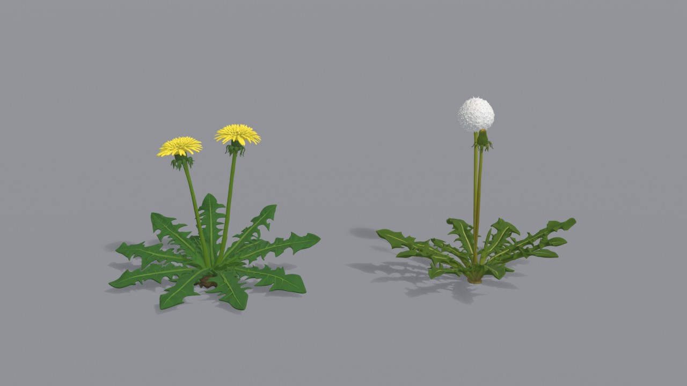

# Dandelion (weed)

The weed in flower and with its seed head.

## File

`dandelion.blend` (15 MB, Blender 4.4 or newer). Textures are packed inside the file.

| Collection | What is in it |
|---|---|
| `Plants` | the plant models, side by side |
| `Preview` | the floor, sun and camera used for the pictures above (delete it if you do not need it) |

## Models

| Object | Kind | Size in metres (x, y, z) | Triangles |
|---|---|---|---|
| `dandelion_flower` | plant | 0.29 x 0.28 x 0.22 | 150,000 |
| `dandelion_seed` | plant | 0.28 x 0.28 x 0.25 | 150,000 |

Each model is one object with one material (base colour, metal and roughness, normal map), named after the model.
Everything is at real size: 1 Blender unit is 1 metre, Z is up. A plant's origin is at the foot of its stem, so it stands on the ground when placed at a point.
