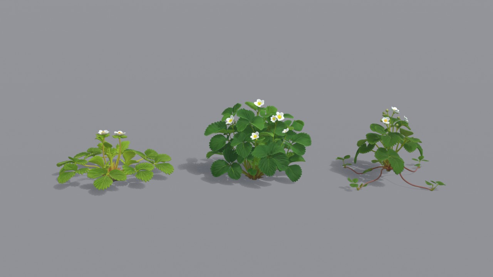
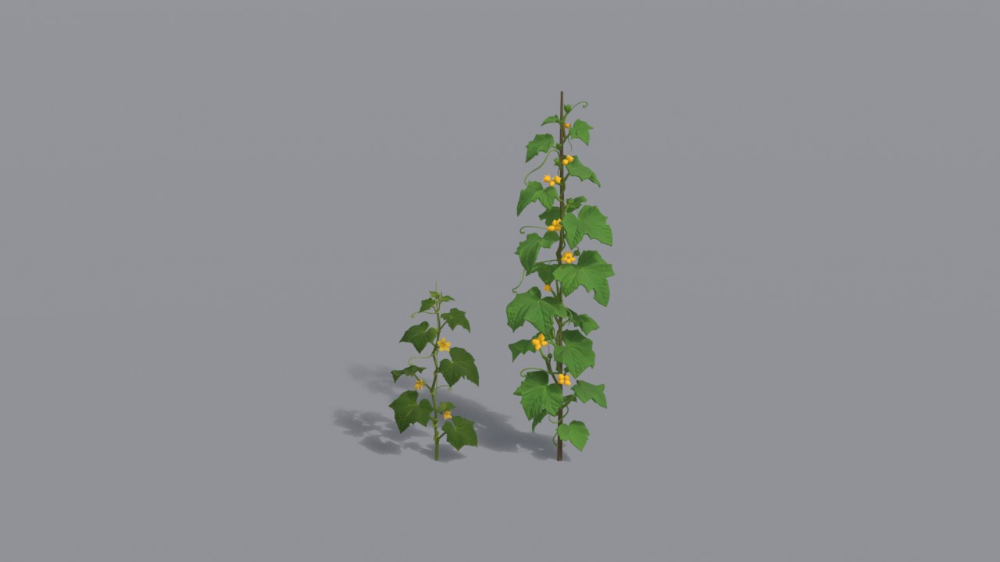
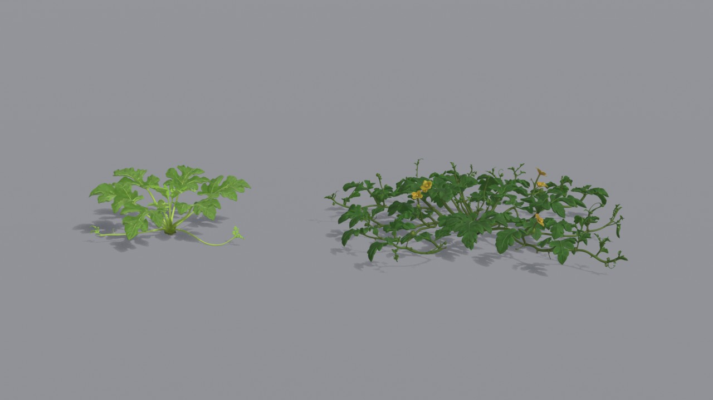
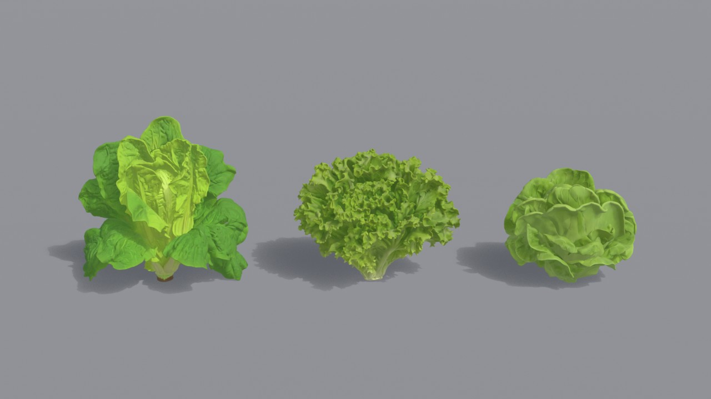
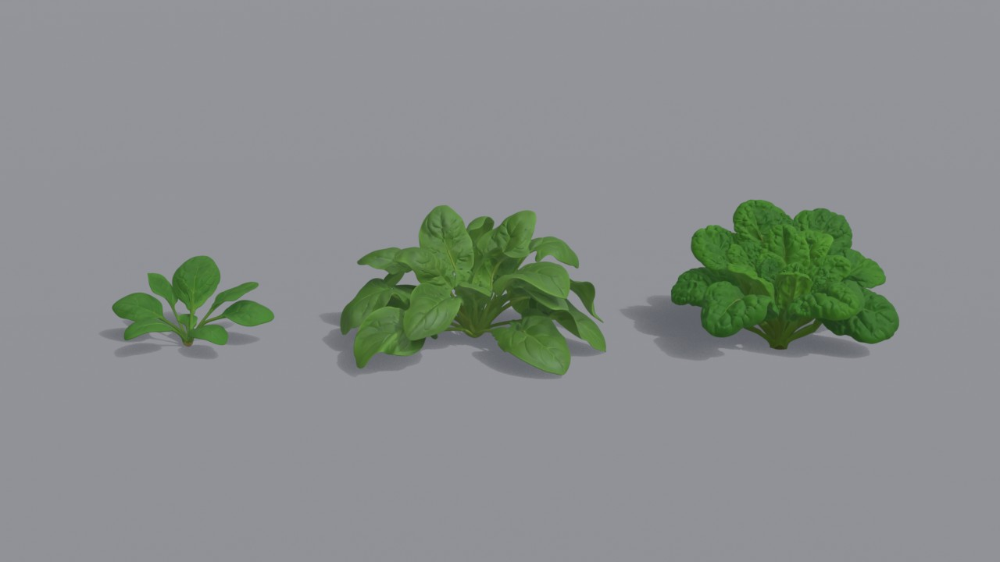
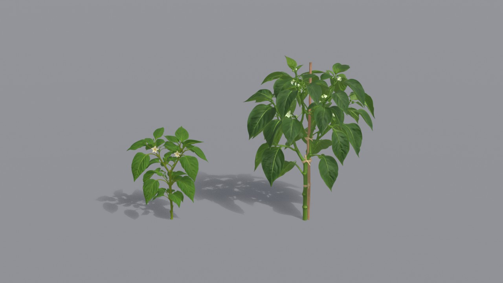
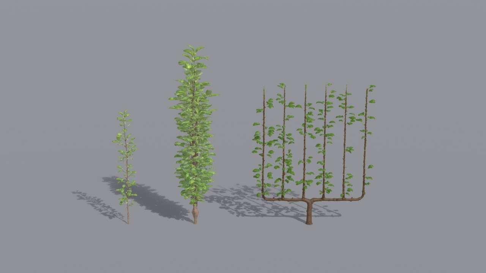
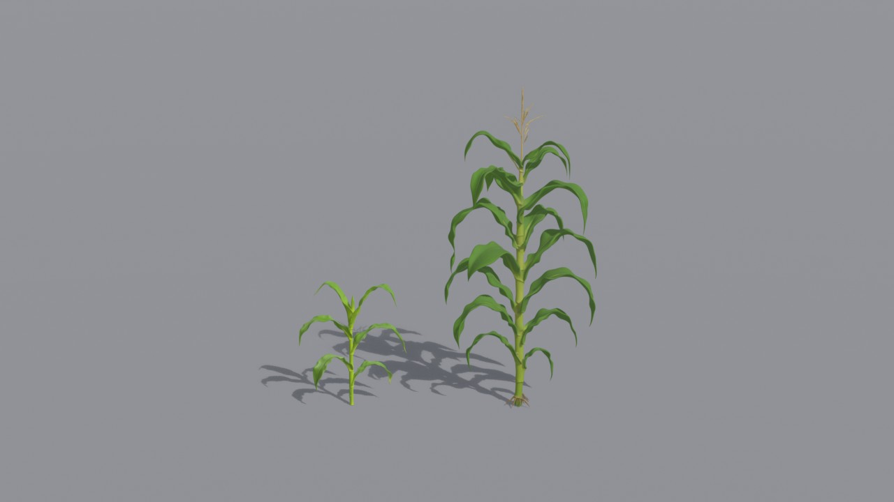
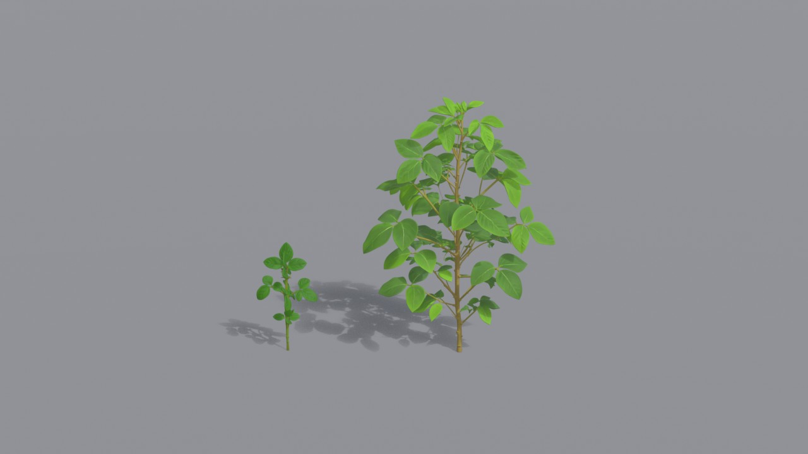
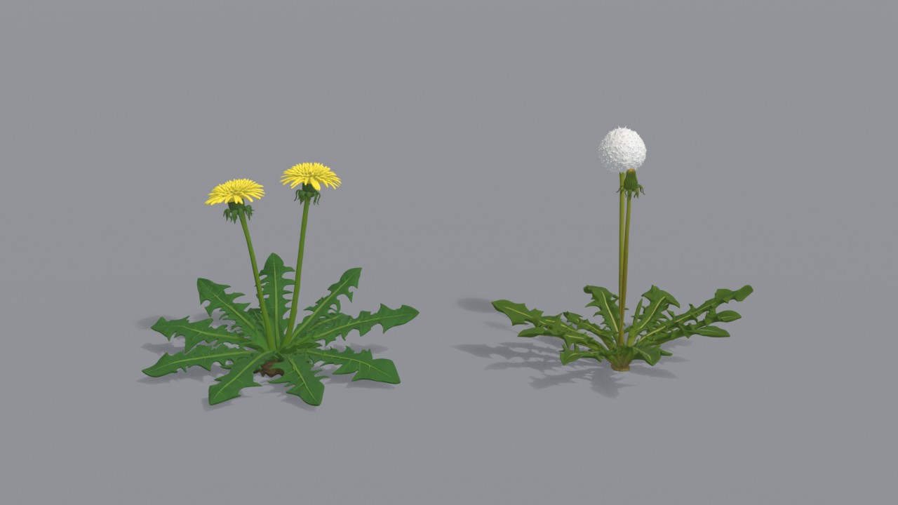

# Crops

Crop models for the farm simulator, added in November 2026: 43 models of ten crops, plants and fruit as separate models,
two or three varieties of each. One Blender file per crop, 208 MB in all.

| Crop | Plants | Fruit | File |
|---|---|---|---|
| [Strawberry](Strawberry/) | 3 | 3 | `Strawberry/strawberry.blend` (27 MB) |
| [Cucumber](Cucumber/) | 2 | 3 | `Cucumber/cucumber.blend` (23 MB) |
| [Watermelon](Watermelon/) | 2 | 3 | `Watermelon/watermelon.blend` (19 MB) |
| [Lettuce](Lettuce/) | 3 | none | `Lettuce/lettuce.blend` (24 MB) |
| [Spinach](Spinach/) | 3 | none | `Spinach/spinach.blend` (21 MB) |
| [Bell pepper](BellPepper/) | 2 | 3 | `BellPepper/bellpepper.blend` (17 MB) |
| [Apple](Apple/) | 3 | 3 | `Apple/apple.blend` (29 MB) |
| [Corn](Corn/) | 2 | 2 | `Corn/corn.blend` (16 MB) |
| [Soybean](Soybean/) | 2 | 2 | `Soybean/soybean.blend` (17 MB) |
| [Dandelion (weed)](Dandelion/) | 2 | none | `Dandelion/dandelion.blend` (15 MB) |

## How the files are laid out

- Blender 4.4 or newer. These files do not open in Blender 2.79, which the older files in this repository were made with.
- Real size: 1 Blender unit is 1 metre, Z is up. A plant's origin is at the foot of its stem.
- The plant and its fruit are separate models, so the simulator can hang any number of fruit on a plant and a robot can pick them one at a time.
- One object and one material per model, both named after the model. Textures are 2048 pixels and packed inside the file.
- Each folder has a README with pictures, sizes and triangle counts.

## Using a model in the farm simulator (Unity)

1. Open the crop's file and select one object.
2. Move it to the world origin (Alt+G), so the exported file has the plant's foot at its origin.
3. File > Export > FBX or Wavefront OBJ, with *Selected Objects* (FBX) or *Selection Only* (OBJ) ticked.
4. In Unity, give its material the base colour and normal map. Leaves need a double-sided material.

The plants here are the full-detail versions (about 150,000 triangles each). The farm simulator uses lighter versions made from them
(6,000 to 30,000 triangles near the camera and a second, lighter one for far away), which live in the simulator project under
`Assets/Resources/RealCrops`.

## Pictures

**Strawberry**

**Cucumber**

**Watermelon**

**Lettuce**

**Spinach**

**Bell pepper**

**Apple**

**Corn**

**Soybean**

**Dandelion (weed)**

