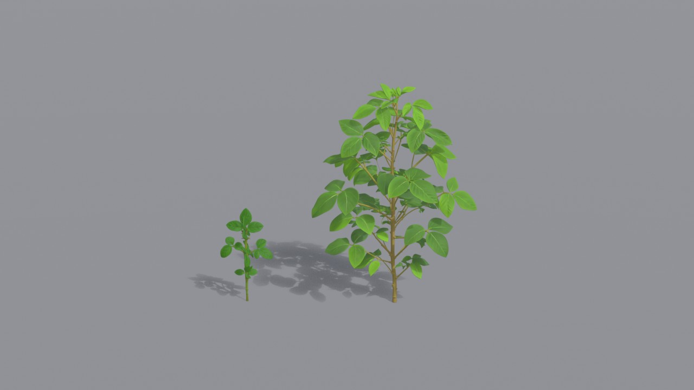
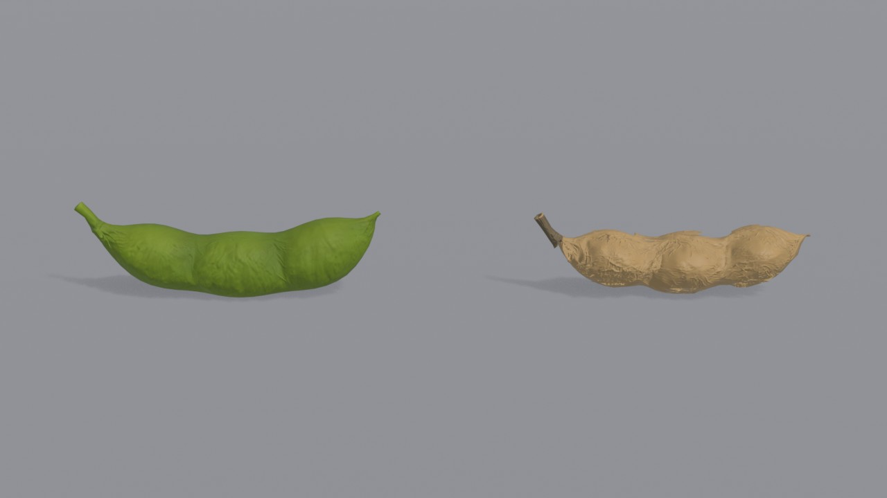

# Soybean

A young and a full grown plant, and two pods: green and dry.

## File

`soybean.blend` (17 MB, Blender 4.4 or newer). Textures are packed inside the file.

| Collection | What is in it |
|---|---|
| `Plants` | the plant models, side by side |
| `Fruit` | the fruit models, in a row in front of the plants |
| `Preview` | the floor, sun and camera used for the pictures above (delete it if you do not need it) |

## Models

| Object | Kind | Size in metres (x, y, z) | Triangles |
|---|---|---|---|
| `soybean_plant_young` | plant | 0.19 x 0.17 x 0.35 | 150,000 |
| `soybean_plant_full` | plant | 0.58 x 0.52 x 0.80 | 150,000 |
| `soybean_pod_green` | fruit | 0.055 x 0.013 x 0.017 | 1,678 |
| `soybean_pod_dry` | fruit | 0.050 x 0.013 x 0.015 | 1,826 |

Each model is one object with one material (base colour, metal and roughness, normal map), named after the model.
Everything is at real size: 1 Blender unit is 1 metre, Z is up. A plant's origin is at the foot of its stem, so it stands on the ground when placed at a point.
