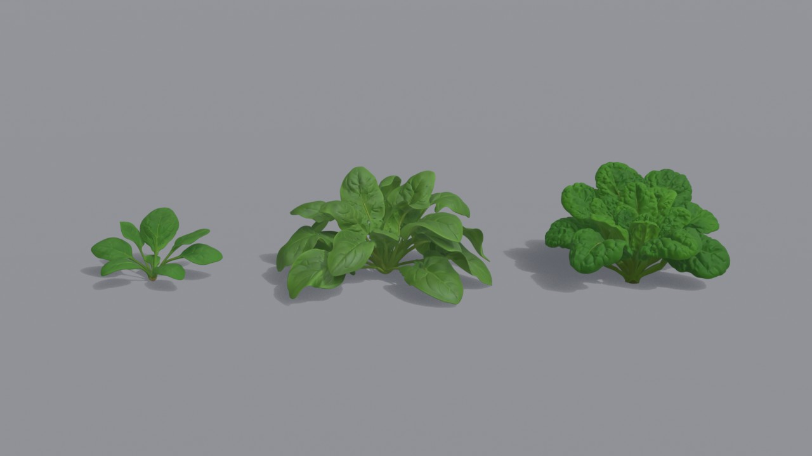

# Spinach

Three kinds: young, flat leaf, savoy. Spinach is cut whole, so there is no fruit model.

## File

`spinach.blend` (21 MB, Blender 4.4 or newer). Textures are packed inside the file.

| Collection | What is in it |
|---|---|
| `Plants` | the plant models, side by side |
| `Preview` | the floor, sun and camera used for the pictures above (delete it if you do not need it) |

## Models

| Object | Kind | Size in metres (x, y, z) | Triangles |
|---|---|---|---|
| `spinach_young` | plant | 0.24 x 0.19 x 0.12 | 150,000 |
| `spinach_flat` | plant | 0.39 x 0.36 x 0.20 | 150,000 |
| `spinach_savoy` | plant | 0.32 x 0.26 x 0.20 | 150,000 |

Each model is one object with one material (base colour, metal and roughness, normal map), named after the model.
Everything is at real size: 1 Blender unit is 1 metre, Z is up. A plant's origin is at the foot of its stem, so it stands on the ground when placed at a point.
