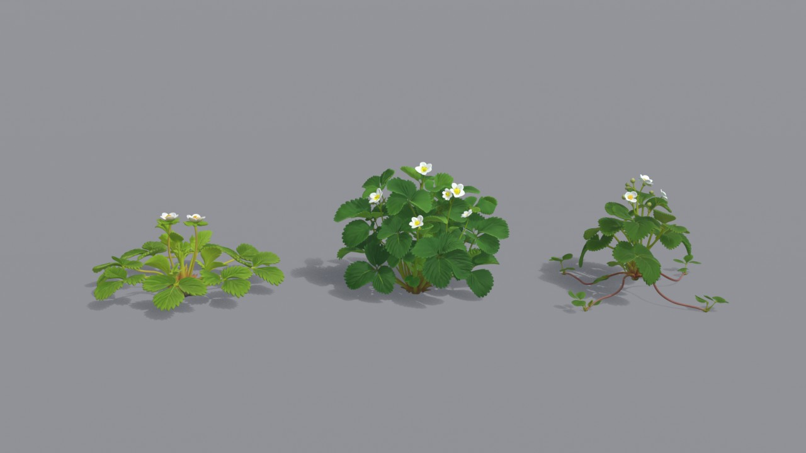
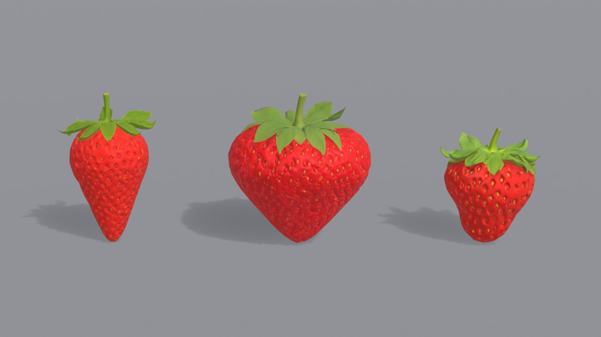

# Strawberry

Three plants (young, full grown, with runners) and three berry shapes (long cone, heart, short cone).

## File

`strawberry.blend` (27 MB, Blender 4.4 or newer). Textures are packed inside the file.

| Collection | What is in it |
|---|---|
| `Plants` | the plant models, side by side |
| `Fruit` | the fruit models, in a row in front of the plants |
| `Preview` | the floor, sun and camera used for the pictures above (delete it if you do not need it) |

## Models

| Object | Kind | Size in metres (x, y, z) | Triangles |
|---|---|---|---|
| `strawberry_plant_young` | plant | 0.36 x 0.38 x 0.15 | 150,000 |
| `strawberry_plant_full` | plant | 0.32 x 0.30 x 0.25 | 150,000 |
| `strawberry_plant_runners` | plant | 0.29 x 0.29 x 0.22 | 150,000 |
| `strawberry_cone` | fruit | 0.027 x 0.024 x 0.045 | 1,393 |
| `strawberry_heart` | fruit | 0.042 x 0.041 x 0.045 | 1,684 |
| `strawberry_short` | fruit | 0.028 x 0.027 x 0.035 | 1,701 |

Each model is one object with one material (base colour, metal and roughness, normal map), named after the model.
Everything is at real size: 1 Blender unit is 1 metre, Z is up. A plant's origin is at the foot of its stem, so it stands on the ground when placed at a point.
