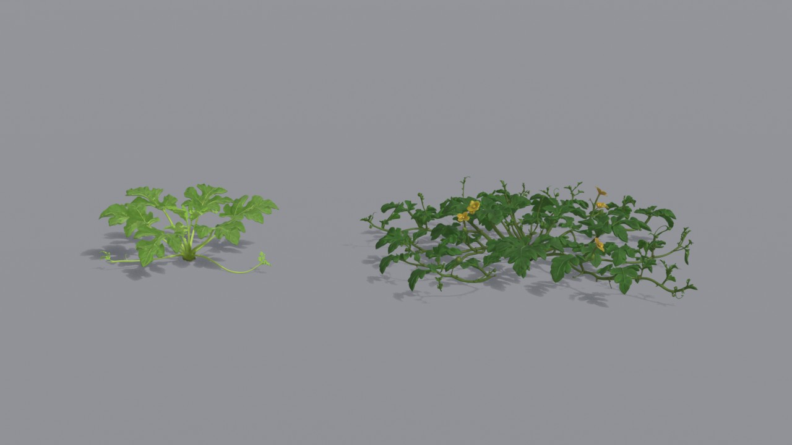
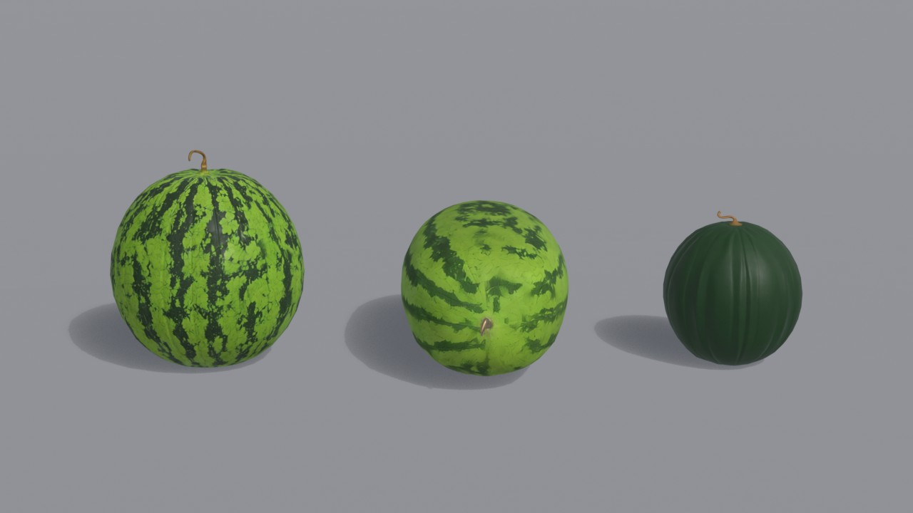

# Watermelon

A young plant and a full vine that lies on the ground, and three melons: round striped, oblong striped, small dark.

## File

`watermelon.blend` (19 MB, Blender 4.4 or newer). Textures are packed inside the file.

| Collection | What is in it |
|---|---|
| `Plants` | the plant models, side by side |
| `Fruit` | the fruit models, in a row in front of the plants |
| `Preview` | the floor, sun and camera used for the pictures above (delete it if you do not need it) |

## Models

| Object | Kind | Size in metres (x, y, z) | Triangles |
|---|---|---|---|
| `watermelon_vine_young` | plant | 0.66 x 0.68 x 0.25 | 150,000 |
| `watermelon_vine_full` | plant | 1.25 x 1.34 x 0.30 | 150,000 |
| `watermelon_round_striped` | fruit | 0.25 x 0.25 x 0.28 | 1,618 |
| `watermelon_oblong_striped` | fruit | 0.22 x 0.42 x 0.20 | 1,828 |
| `watermelon_small_dark` | fruit | 0.18 x 0.18 x 0.20 | 1,842 |

Each model is one object with one material (base colour, metal and roughness, normal map), named after the model.
Everything is at real size: 1 Blender unit is 1 metre, Z is up. A plant's origin is at the foot of its stem, so it stands on the ground when placed at a point.
