<p align="center">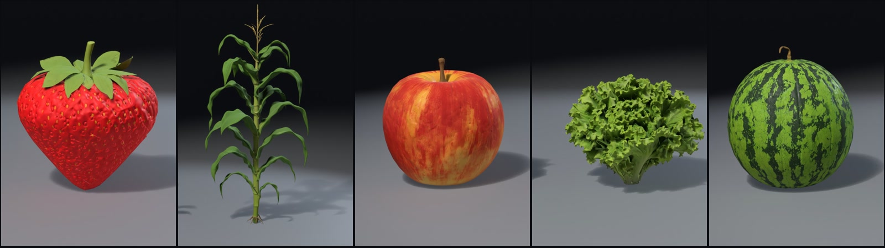</p>

<h1 align="center">Farm Simulator Blender Assets</h1>

<p align="center">The 3D models and animations behind the lab's <a href="https://github.com/greatroboticslab/FarmSimulator">farm simulator</a>:<br>crops, robots, machines, and the scripts that get them into Unity.</p>

<p align="center">
  
  
  
  
</p>

<p align="center"><a href="#crop-models">Crop models</a> &nbsp;|&nbsp; <a href="#what-is-in-this-repository">Folders</a> &nbsp;|&nbsp; <a href="#quick-start">Quick start</a> &nbsp;|&nbsp; <a href="#guides">Guides</a></p>

## Crop models

43 models of ten crops, added in November 2026. The plant and its fruit are separate models, so the simulator can hang any number of fruit on a plant and a robot can pick them one at a time. Every crop has two or three varieties and comes at real size. One Blender file per crop, in [`Crops/`](Crops/).

<table>
  <tr>
    <td align="center" width="20%"><a href="Crops/Strawberry/">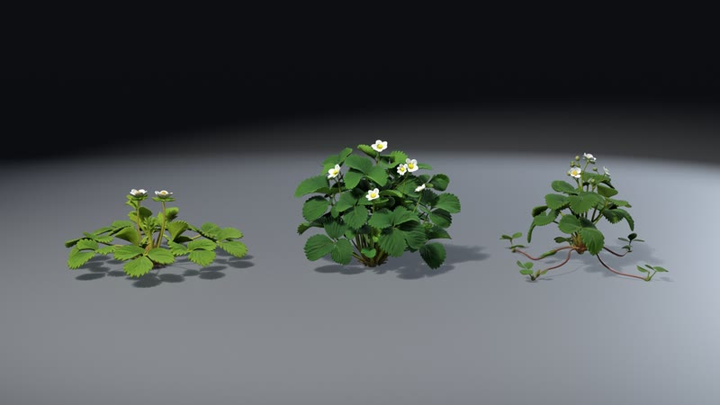<br><b>Strawberry</b></a><br><sub>3 plants, 3 fruit</sub></td>
    <td align="center" width="20%"><a href="Crops/Cucumber/">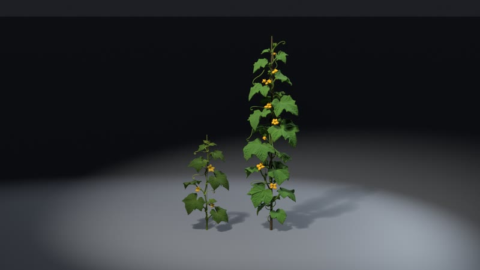<br><b>Cucumber</b></a><br><sub>2 plants, 3 fruit</sub></td>
    <td align="center" width="20%"><a href="Crops/Watermelon/">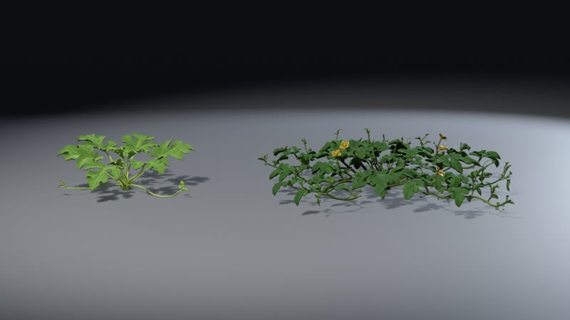<br><b>Watermelon</b></a><br><sub>2 plants, 3 fruit</sub></td>
    <td align="center" width="20%"><a href="Crops/Lettuce/">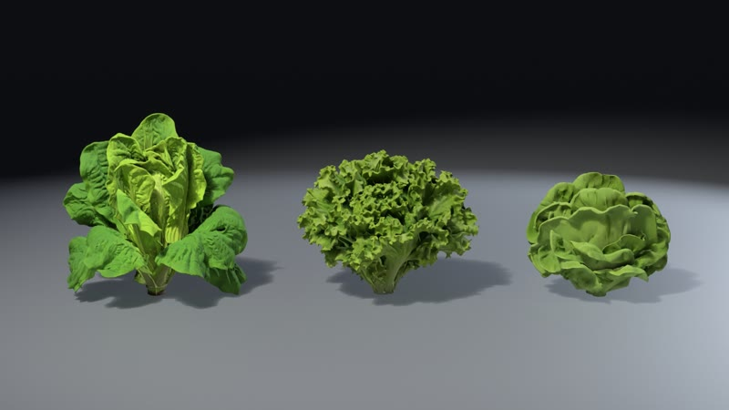<br><b>Lettuce</b></a><br><sub>3 plants</sub></td>
    <td align="center" width="20%"><a href="Crops/Spinach/">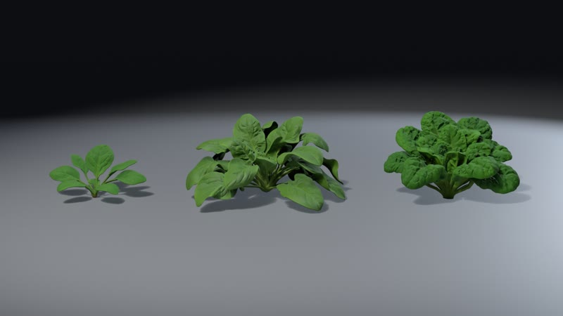<br><b>Spinach</b></a><br><sub>3 plants</sub></td>
  </tr>
  <tr>
    <td align="center" width="20%"><a href="Crops/BellPepper/">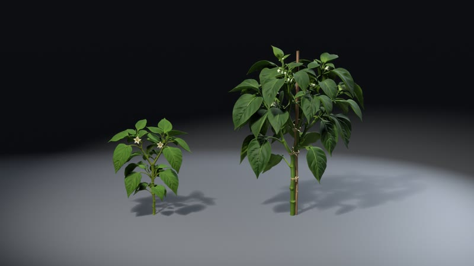<br><b>Bell pepper</b></a><br><sub>2 plants, 3 fruit</sub></td>
    <td align="center" width="20%"><a href="Crops/Apple/">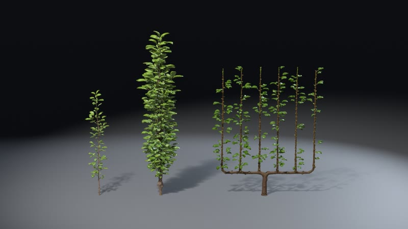<br><b>Apple</b></a><br><sub>3 plants, 3 fruit</sub></td>
    <td align="center" width="20%"><a href="Crops/Corn/">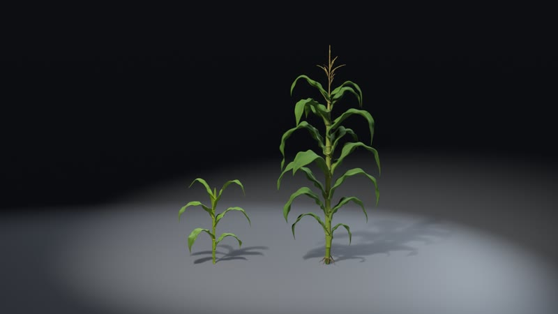<br><b>Corn</b></a><br><sub>2 plants, 2 fruit</sub></td>
    <td align="center" width="20%"><a href="Crops/Soybean/">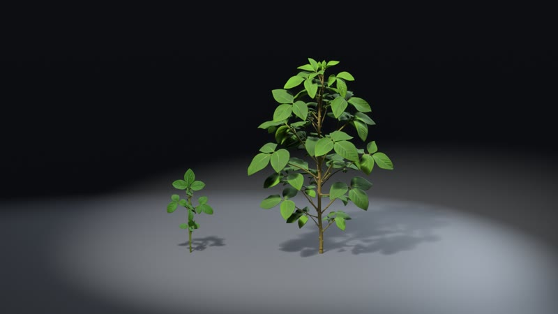<br><b>Soybean</b></a><br><sub>2 plants, 2 fruit</sub></td>
    <td align="center" width="20%"><a href="Crops/Dandelion/">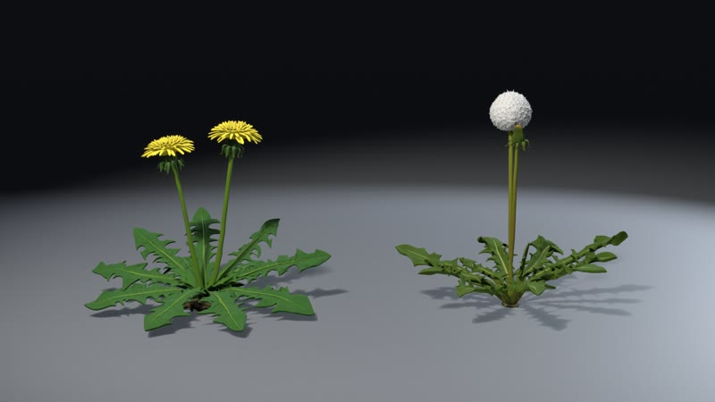<br><b>Dandelion (weed)</b></a><br><sub>2 plants</sub></td>
  </tr>
</table>

<p align="center">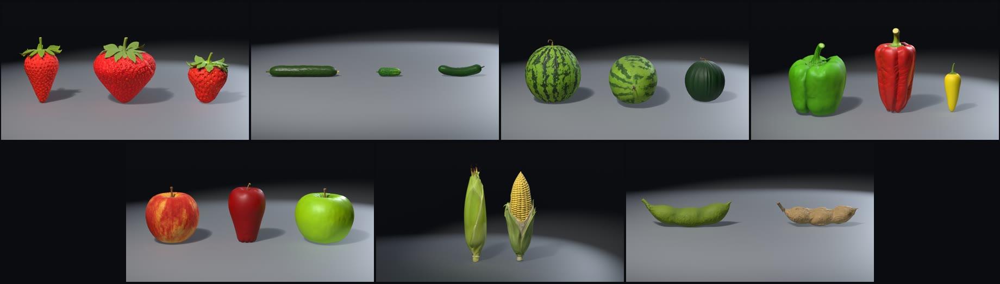</p>

Each crop folder has its own README with pictures, sizes and triangle counts. [`Crops/README.md`](Crops/README.md) explains how the files are laid out and how to take a model into Unity.

## What is in this repository

| Folder | What it holds |
|---|---|
| [`Crops/`](Crops/) | The crop models above: strawberry, cucumber, watermelon, lettuce, spinach, bell pepper, apple, corn, soybean and dandelion. Blender 4.4 files with packed textures. |
| [`Plants/`](Plants/) | Earlier plant models as .obj, with a few .blend files: bell pepper, corn, dandelion, soybean, the dirt row, plastic mulch and the pepper stake. |
| [`output/`](output/) | Scanned (VGGT) models after the post-processing guide below: apple, bell pepper, cabbage, strawberry plant. |
| [`BlenderWIP/`](BlenderWIP/) | The cabbage, work in progress. |
| [`Rover/`](Rover/), [`Tractor/`](Tractor/), [`Tools/`](Tools/) | The rovers and their parts, the tractor and plow, and hand tools. |
| [`Map/`](Map/), [`Misc/`](Misc/) | Map pieces (building, dirt patch, ground plane) and small helpers (markers, waypoint cone, person template). |
| [`Humanoid Animations/`](Humanoid%20Animations/), [`Tractor Animations/`](Tractor%20Animations/) | Humanoid animation .blend files with their .fbx exports. |
| [`Data/`](Data/) | Motion data and conversion tests (.fbx, .bvh). `Data/unity_fbx_files` and `Data/momask_bvh_files` are not tracked. |
| [`scripts/`](scripts/) | The .bvh and .npz conversion scripts and the copy-to-Unity script. |
| [`docs/`](docs/) | The step-by-step guides. |
| [`Media/`](Media/), [`Recordings/`](Recordings/) | Pictures used by the READMEs, and a screen recording. |

## Quick start

1. Get the files. The repository is large (about 2 GB), so a shallow clone is quicker:
   ```
   git clone --depth 1 https://github.com/greatroboticslab/FarmSimulatorBlender.git
   ```
2. Open a crop in Blender 4.4 or newer, for example `Crops/Lettuce/lettuce.blend`. Everything is at real size (1 unit is 1 metre, Z up) and the textures are inside the file.
3. To take a model into the farm simulator: select one object, move it to the world origin (Alt+G), and export it as FBX or OBJ with *Selected Objects* ticked. The details are in [`Crops/README.md`](Crops/README.md).

The older files (animations, rovers, tractor, the earlier plants) were made with Blender 2.79. Newer Blender versions open them; Blender 2.79 does not open the files in `Crops/`.

## Robots, machines and animations

The humanoid, the tractor and the rovers of the simulator are here too, with the humanoid's animations as .blend files and .fbx exports.

<p align="center">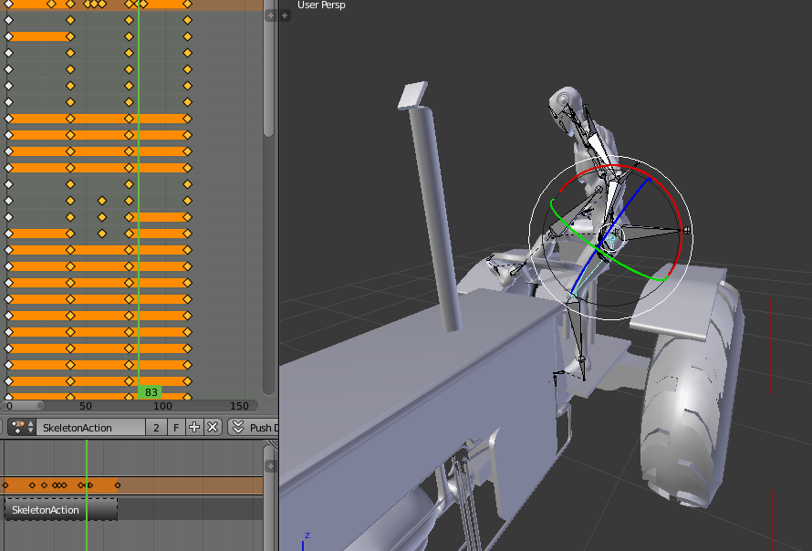</p>

## Guides

| Guide | What it covers |
|---|---|
| [Preparing a scanned (VGGT) model](docs/vggt_post_processing.md) | Fifteen steps with pictures: import the remeshed point cloud, place it at the origin, lay out its UVs, cut away the background, export it for Unity. |
| [File conversion](docs/file_conversion.md) | Importing, exporting and previewing .npz motion files (IsaacLab), and turning MoMask .bvh files into .fbx animations for Unity. |
| [Crop models](Crops/README.md) | How the crop files are laid out and how to use a model in Unity. |
