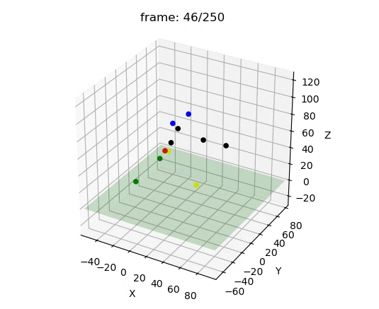
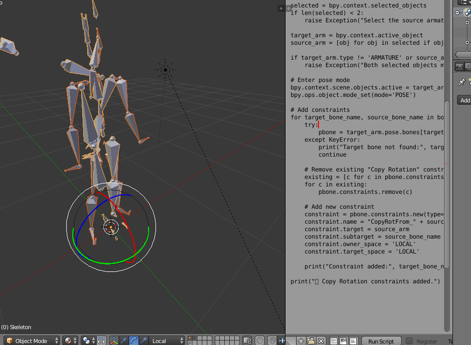

[Back to the main page](../README.md)

# File conversion (.npz and .bvh)

Here are the handy tools for file conversion to make assets workable with blender. They are located in the scripts folder.

## .npz Conversion

### Importing

import_npz.py is a python script that at the moment will import reverse_engineering_test.npz in the same directory as the Blender project.

### Exporting

export_npz.py is a python script that when run, will convert a selected skeleton to a .npz format to be used with IsaacLab. To run it, simply open a project, and select a skeleton. Then, open a new window bar, and choose text editor. In the editor, open the export_npz.py file and then click Run Script. It will output a .npz file in the same directory as the Blender project.

### Preview

You can preview a .npz animation with the command:

	motion_viewer.py --file <file.npz>
	
Matplotlib, Numpy, and PyTorch are required to run.

motion_loader.py is used to view statistic of a .npz animation. To run:

	motion_loader.py --file <file.npz>

## MoMask / .bvh Conversion

### Automatically

You can use .bvh files generated by [MoMask](https://github.com/EricGuo5513/momask-codes) to create animations too.

	bash convert_all_bvh.sh

Or do:

	blender -b -P bvh_to_fbx.py -- [path to .bvh]

to do just one animation.

When finished, run:

	bash copy_to_unity.sh

to copy all the converted .fbx animations to Unity.

### Manually

Open a new Blender project with the Unity humanoid skeleton. Then import the .bvh file. Now first select the .bvh skeleton, then shift-right-click the Unity skeleton so that it is yellow. Then open a new text editor window, open **convert_bvh.py**, and run it. The animations should now be converted to the Unity skeleton, and you can export it.

When finished, drag and drop the exported .fbx animation files into the Unity Assets folder for use in animations.
