[Back to the main page](../README.md)

# Preparing a scanned (VGGT) model in Blender 

In the following, I will show you how to do aapple assests making using the blender and once finished, it can be expored to Unity 

## VGGT Post-Processing and Export

Remeshed VGGT pointclouds need to be processed in Blender before they can be exported to Unity.

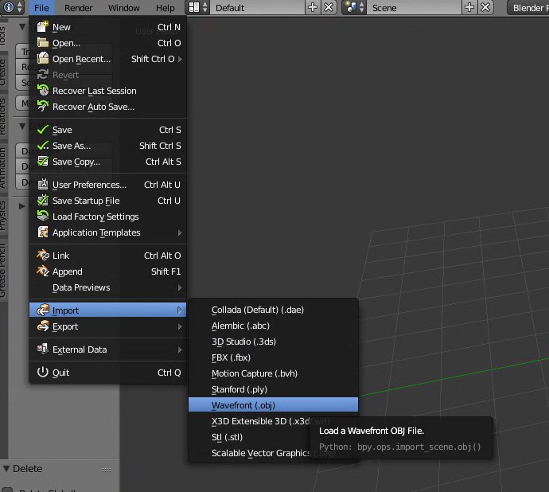

1. Import the remeshed pointcloud .obj (processed by MeshLab) into Blender.

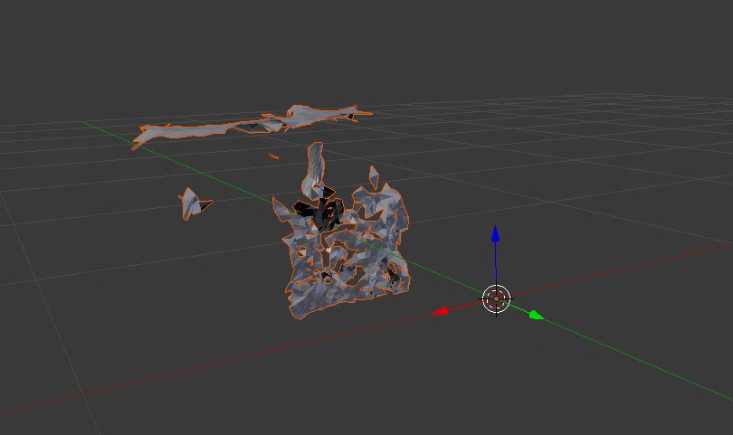

2. It should look like this. Press TAB to go into edit mode.

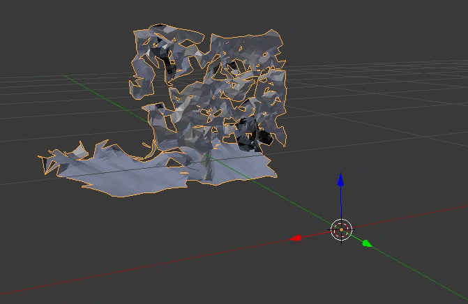

3. Rotate the mesh 180 degrees along the Y axis.

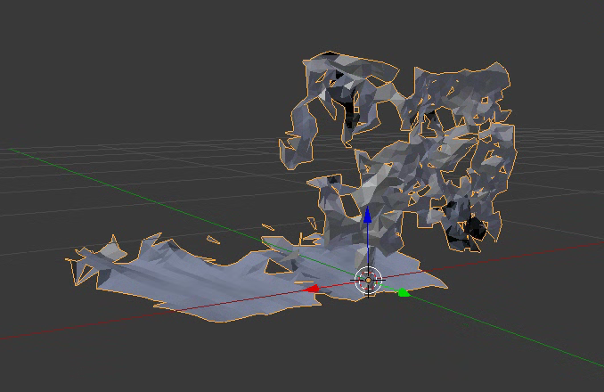

4.  Move the center of the fruit/plant to be located at the origin. This typically only involves moving the mesh in the direction of the green arrow.

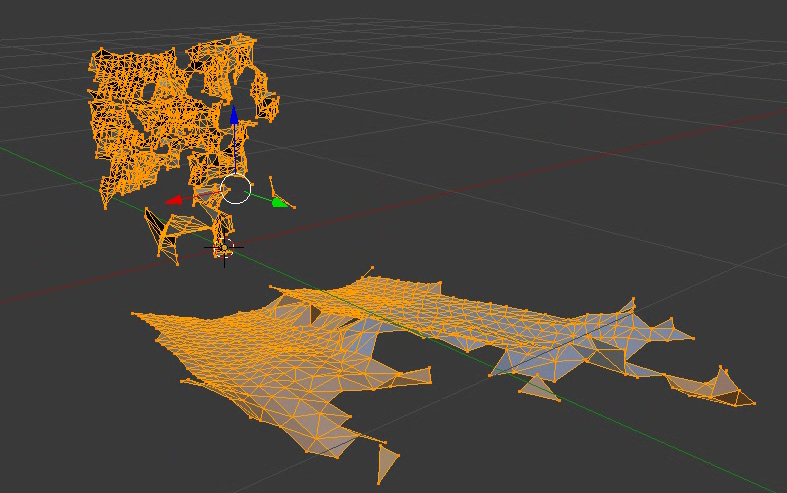

5. Rotate the mesh along the Z axis 180 degrees, so that the back of the mesh is pointing the same direction as the green arrow.

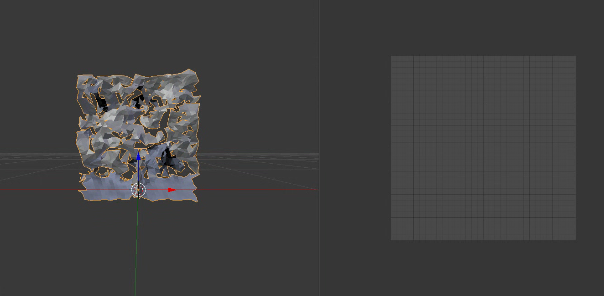

6. Split the view into the 3D viewer and the UV image editor. Then press numpad 1 to view the model from the front. Zoom in and hold shift + middle mouse button to move the view until the front of the mesh is roughly square shaped.

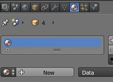

7. Exit edit mode, and create a new material in the materials tab.

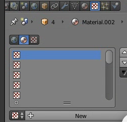

8. Once a new material is created, go to the texture tab and create a new texture.

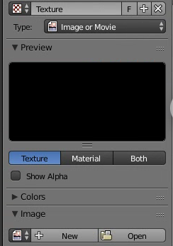

9. After making the new texture, click the open button, and selected the mesh's texture, typically located in the Data/vggt_images/ folder.

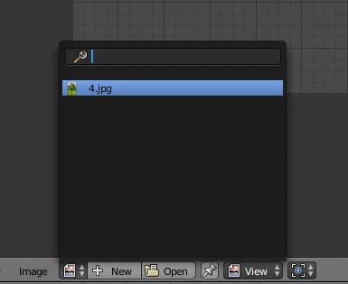

10. Open the image preview in the UV image editor.

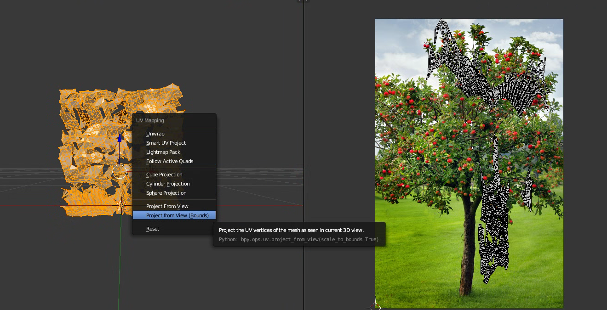

11. Select the mesh, go into edit mode, and select all the vertices. Then press U, and choose Project from View (Bounds).

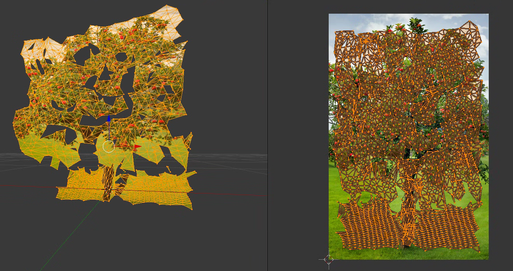

12. The UV layout should be roughly square shaped in the UV Image Editor. scale and move the UVs to match the mesh. You can go into Texture preview mode to preview the mesh and its texture in the 3D view.

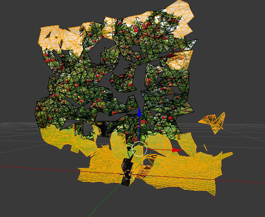

13. While in edit mode, select faces of the mesh that should be deleted (background). Select face mode, and press C to use the circle select tool to more easily select them.

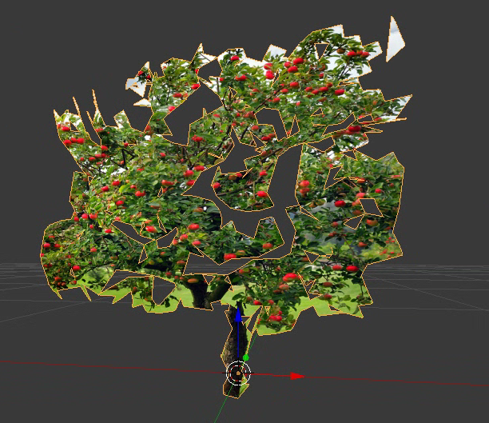

14. Delete these faces, and exit edit mode.

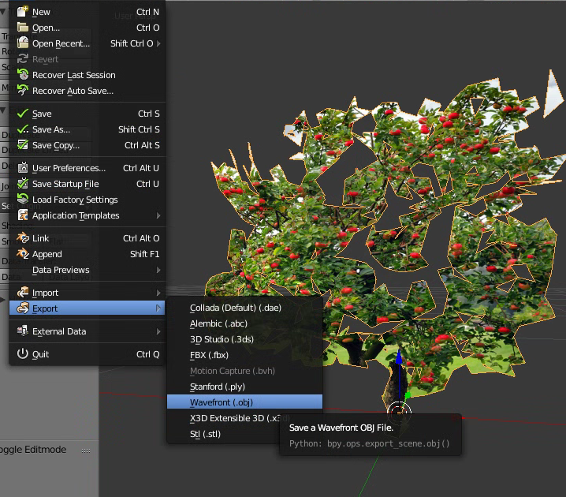

15. Export the mesh as an .obj to the output/ folder.
